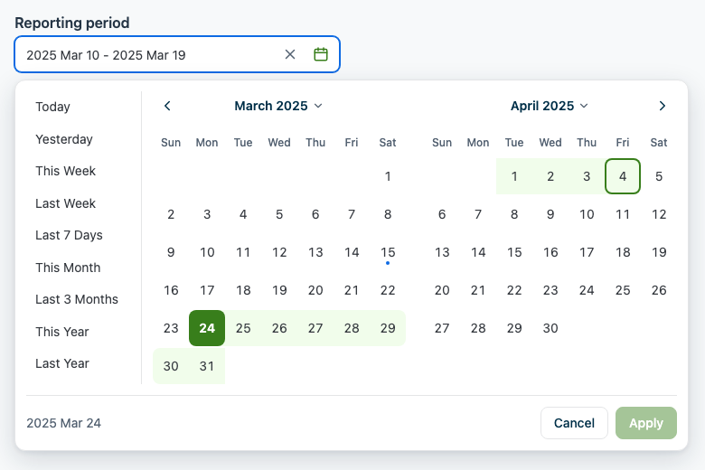
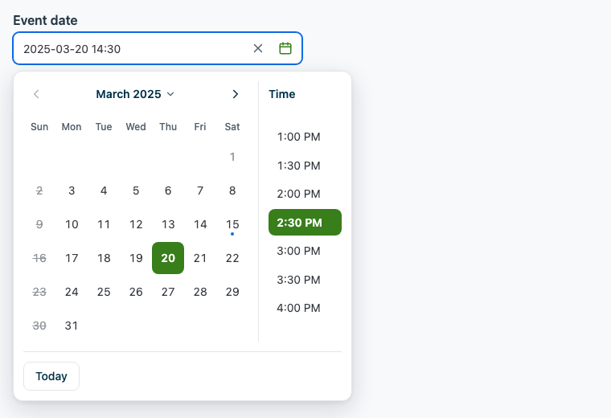
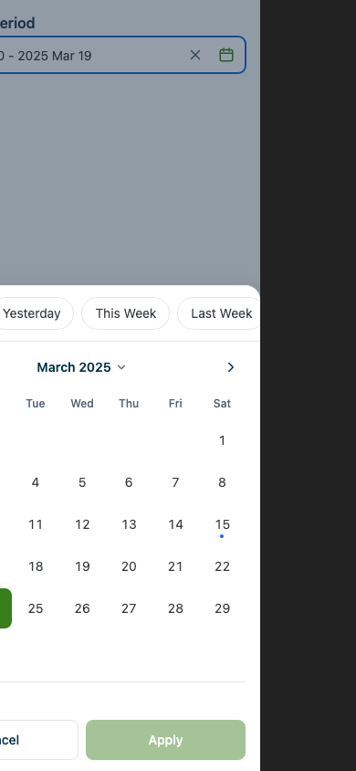
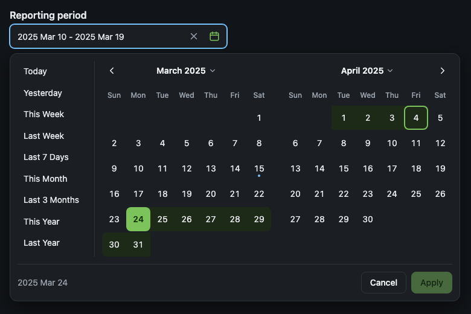

# @mbanda1/date-picker

Accessible date and date-range pickers for React and Next.js. Use the ready-made components with the default stylesheet, or use the headless hooks with your own markup and design system.

- No UI framework required. Runtime dependency: `@floating-ui/react-dom` (~3 kB). Peers: `react`, `react-dom`, `date-fns`.
- Responsive: a positioned popover on desktop, a bottom sheet under 640px.
- Keyboard and screen-reader support following the WAI-ARIA date picker dialog pattern.
- Localised month and weekday names and first day of the week, via `Intl`.
- Server-rendering safe, with `'use client'` built in for the Next.js App Router.
- Fully typed, ESM and CommonJS.



## Installation

```bash
pnpm add @mbanda1/date-picker date-fns
# or
npm install @mbanda1/date-picker date-fns
```

| Peer dependency | Version |
| --- | --- |
| `react`, `react-dom` | `>= 18` |
| `date-fns` | `^3 \|\| ^4` |

## Quick start

Import the stylesheet once, for example in your root layout or `_app.tsx`:

```tsx
import '@mbanda1/date-picker/styles.css';
```

### Single date



```tsx
import { useState } from 'react';
import { DatePicker } from '@mbanda1/date-picker';

export function EventDateField() {
  const [date, setDate] = useState<Date | null>(null);

  return (
    <>
      <label htmlFor='event-date'>Event date</label>
      <DatePicker
        id='event-date'
        value={date}
        onChange={setDate}
        minDate={new Date()}
        showTime
        minTime='09:00'
        maxTime='18:00'
        timeInterval={30}
      />
    </>
  );
}
```

### Date range

```tsx
import { useState } from 'react';
import { DateRangePicker, type DateRange } from '@mbanda1/date-picker';

export function ReportFilter() {
  const [range, setRange] = useState<DateRange>({ start: null, end: null });

  return <DateRangePicker aria-label='Reporting period' value={range} onChange={setRange} presets />;
}
```

`onChange` fires when the user clicks **Apply**. `range.start` is at the start of its day and `range.end` at the end of its day, so you can pass both straight to an API filter. Set `autoApply` to commit as soon as both ends are picked, with no Apply step.

### React Hook Form

The components forward `ref`, `onBlur` and `name`, so `Controller` works without a wrapper. RHF can focus the field on a validation error and mark it as touched.

```tsx
import { Controller, useForm } from 'react-hook-form';
import { DatePicker, DateRangePicker, type DateRange } from '@mbanda1/date-picker';

type FormValues = { eventDate: Date | null; period: DateRange };

export function BookingForm() {
  const { control, handleSubmit } = useForm<FormValues>({
    defaultValues: { eventDate: null, period: { start: null, end: null } },
  });

  return (
    <form onSubmit={handleSubmit(console.log)}>
      <Controller
        control={control}
        name='eventDate'
        rules={{ required: true }}
        render={({ field, fieldState }) => (
          <DatePicker {...field} aria-label='Event date' invalid={fieldState.invalid} />
        )}
      />
      <Controller
        control={control}
        name='period'
        render={({ field }) => <DateRangePicker {...field} aria-label='Period' presets />}
      />
      <button type='submit'>Save</button>
    </form>
  );
}
```

### Plain forms and Server Actions

Pass `name` to render a hidden input with an ISO value: `2025-03-20` (or `2025-03-20T14:30` with `showTime`) for a single date, and `2025-03-01/2025-03-31` for a range.

```tsx
<form action={createBooking}>
  <DatePicker name='date' aria-label='Date' />
</form>
```

### Next.js

Both entry points already include `'use client'`, so you can render the components from a Server Component. The calendar only renders after the user opens it, so hydration is stable. If you show "today" in server-rendered output, pass `now={…}` so the server and the browser agree on the date.

## Mobile

Below 640px wide (configurable with `sheetBreakpoint`, or `null` to turn it off), the picker opens as a bottom sheet:

- The range picker shows one month instead of two.
- Presets become a scrolling row of chips.
- Tap targets are 44px.
- The time list scrolls sideways.
- The page behind the sheet can't scroll while it's open.



## Theming

All rules have zero specificity (`:where()`), so your own CSS always wins. Most theming only needs CSS variables, set on `:root`, on any ancestor, or on the `className` / `popoverClassName` you pass. The popover renders inside `<body>`, so per-instance variables have to go on `popoverClassName` as well.

```css
:root {
  --dp-accent: #4f46e5;
  --dp-accent-hover: #4338ca;
  --dp-range: #e0e7ff;
  --dp-radius: 6px;
  --dp-font: 'Inter', sans-serif;
}
```

| Variable | Default | Used for |
| --- | --- | --- |
| `--dp-accent` / `--dp-accent-hover` / `--dp-accent-fg` | `#387e1b` / `#236609` / `#fff` | Selected day, month, year, time and preset; Apply button |
| `--dp-range` / `--dp-range-preview` | `#d6f1ca` / `#f1fdeb` | Range band and hover preview |
| `--dp-bg` / `--dp-fg` / `--dp-heading` / `--dp-muted` | `#fff` / `#363a40` / `#003049` / `#536171` | Surfaces and text |
| `--dp-border` / `--dp-field-border` / `--dp-hover` | `#e4e5e7` / `#787c82` / `#f4f5f6` | Dividers, input border, hover |
| `--dp-today` / `--dp-focus` / `--dp-invalid` / `--dp-disabled` | `#0d6ae3` / `#0d6ae3` / `#c52516` / `#91969c` | Today marker, focus ring, error border, disabled text |
| `--dp-radius` / `--dp-day-radius` | `8px` | Corner radius |
| `--dp-cell-size` / `--dp-field-height` | `2.5rem` (sheet: `2.75rem`) / `2.5rem` | Day size, input height |
| `--dp-font` / `--dp-font-size` | `inherit` / `0.875rem` | Typography |
| `--dp-shadow` / `--dp-backdrop` / `--dp-z-index` | | Popover shadow, sheet backdrop, stacking |

The default colours meet WCAG AA contrast. For **dark mode**, add `.dark` or `[data-theme="dark"]` to an ancestor (the conventions used by `next-themes` and Tailwind). You can override the dark values with the same variables inside your own dark selector.



To style elements directly, use the `dp-*` classes (`.dp-day`, `.dp-cell`, `.dp-title`, …) together with state attributes: `data-selected`, `data-today`, `data-in-range`, `data-range-start`, `data-range-end`, `data-preview`, `data-disabled`, `data-unavailable`, `data-outside-month`, `data-open`, `data-layout="popover|sheet"`.

## Headless hooks

Using Tailwind, MUI, shadcn or your own design system? Use `@mbanda1/date-picker/headless`. You get the same behaviour, keyboard model and ARIA, and you render all the markup yourself. Every prop getter returns the right attributes and handlers to spread onto your element.

```tsx
import { useDatePicker } from '@mbanda1/date-picker/headless';

export function TailwindDatePicker(props: { value: Date | null; onChange: (d: Date | null) => void }) {
  const picker = useDatePicker(props);
  const { calendar } = picker;

  return (
    <div className='relative'>
      <div {...picker.getFieldProps()} className='flex rounded border'>
        <input {...picker.getInputProps()} value={picker.inputValue} className='flex-1 px-3 py-2' />
        <button {...picker.getTriggerProps()}>📅</button>
      </div>

      {picker.isOpen && (
        <div {...picker.getDialogProps()} className='rounded bg-white p-3 shadow-lg'>
          {calendar.view === 'days' &&
            calendar.panels.map(panel => (
              <div key={panel.index}>
                <div className='flex justify-between'>
                  <button {...calendar.getPrevButtonProps()}>‹</button>
                  <button {...calendar.getTitleButtonProps(panel.index)}>
                    <span id={panel.titleId}>{panel.title}</span>
                  </button>
                  <button {...calendar.getNextButtonProps()}>›</button>
                </div>
                <div {...calendar.getGridProps(panel.index)}>
                  {panel.weeks.map(week => (
                    <div role='row' key={week[0].date.getTime()} className='grid grid-cols-7'>
                      {week.map(cell => (
                        <div key={cell.date.getTime()} {...calendar.getDayCellProps(cell)}>
                          {!cell.isOutsideMonth && (
                            <button
                              {...calendar.getDayProps(cell)}
                              className='size-10 rounded data-[selected]:bg-indigo-600 data-[selected]:text-white'
                            >
                              {cell.label}
                            </button>
                          )}
                        </div>
                      ))}
                    </div>
                  ))}
                </div>
              </div>
            ))}
          {/* calendar.view === 'months' | 'years': render calendar.months / calendar.years with getMonthProps / getYearProps */}
        </div>
      )}
    </div>
  );
}
```

The same entry point exports the framework-free core (`createInitialState`, `transition`, `getDayCells`, `getTimeOptions`, `DEFAULT_RANGE_PRESETS`, …). It's plain TypeScript with no React, for teams building on another framework.

## Keyboard

| Key | Action |
| --- | --- |
| `Enter`, `Space`, `↓` on the input | Open the picker and focus the selected day |
| `←` `→` `↑` `↓` | Previous or next day / week (left and right swap with `dir="rtl"`) |
| `PageUp` / `PageDown` | Previous or next month (with `Shift`: year) |
| `Home` / `End` | First or last day of the week |
| `Enter` / `Space` | Pick the focused day |
| `Tab` | Move between controls (kept inside the popover) |
| `Esc` | Close and return focus to the input |

## API

### Shared props

| Prop | Type | Default | Description |
| --- | --- | --- | --- |
| `minDate` / `maxDate` | `Date` | | Inclusive bounds. Navigation and selection stop at them. |
| `isDateUnavailable` | `(date: Date) => boolean` | | Mark extra days as unavailable (weekends, holidays). |
| `disabled` | `boolean` | `false` | |
| `invalid` / `required` | `boolean` | `false` | Sets `aria-invalid` / `aria-required` and the error style. |
| `locale` | `string` | `'en-US'` | BCP 47 locale for month and weekday names and time labels. |
| `weekStartsOn` | `0`–`6` | From `locale` | First day of the week (0 = Sunday). |
| `dateFormat` | `string \| (date) => string` | See each component | `date-fns` format string or formatter for the input text. |
| `placeholder` | `string` | | |
| `clearable` | `boolean` | `true` | Show a clear button when there is a value. |
| `defaultMonth` | `Date` | Today | Month to show when nothing is selected. |
| `fixedWeeks` | `boolean` | `false` | Always render 6 weeks so the height never changes. |
| `sheetBreakpoint` | `number \| null` | `640` | Viewport width (px) below which the bottom sheet is used. |
| `labels` | `Partial<PickerLabels>` | English | Translate button and dialog labels. |
| `now` | `Date` | `new Date()` | Fixed current time (for server rendering and tests). |
| `dir` | `'ltr' \| 'rtl'` | `'ltr'` | Flips horizontal arrow keys. |
| `name` | `string` | | Adds a hidden input with an ISO value. |
| `id`, `aria-label`, `aria-labelledby`, `aria-describedby`, `onBlur` | | | Passed to the input. |
| `className` / `popoverClassName` | `string` | | Classes for the field wrapper and the popover. |
| `portal` | `boolean` | `true` | Render the popover inside `document.body`. |
| `onOpenChange` | `(open: boolean) => void` | | |

### `DatePicker`

| Prop | Type | Default | Description |
| --- | --- | --- | --- |
| `value` / `defaultValue` | `Date \| null` | | Controlled or uncontrolled value. |
| `onChange` | `(date: Date \| null) => void` | | |
| `dateFormat` | | `'yyyy-MM-dd'` (`'yyyy-MM-dd HH:mm'` with time) | |
| `showTime` | `boolean` | `false` | Show a time list. `onChange` fires once a time is chosen. |
| `timeInterval` | `number` | `30` | Minutes between time options. |
| `minTime` / `maxTime` | `'HH:mm'` | `'00:00'` / `'23:59'` | |
| `hour12` | `boolean` | From `locale` | Force 12- or 24-hour labels. |
| `closeOnSelect` | `boolean` | `true` | Close after picking a day (when `showTime` is off). |
| `showTodayButton` | `boolean` | `true` | |

### `DateRangePicker`

| Prop | Type | Default | Description |
| --- | --- | --- | --- |
| `value` / `defaultValue` | `DateRange` | `{ start: null, end: null }` | Controlled or uncontrolled range. |
| `onChange` | `(range: DateRange) => void` | | Fires on Apply (or immediately with `autoApply`). |
| `dateFormat` | | `'yyyy MMM d'` | |
| `separator` | `string` | `' - '` | Text between the two dates in the input. |
| `numberOfMonths` | `number` | `2` | Months shown side by side on desktop. |
| `presets` | `boolean \| RangePreset[]` | `false` | `true` for the built-in presets, or your own list. |
| `autoApply` | `boolean` | `false` | Commit and close as soon as both ends are picked. |
| `applyDisabled` | `boolean` | `false` | Disable Apply, e.g. while saving. |

A custom preset:

```ts
import { startOfQuarter, endOfQuarter } from 'date-fns';
import { DEFAULT_RANGE_PRESETS, type RangePreset } from '@mbanda1/date-picker';

const thisQuarter: RangePreset = {
  id: 'this-quarter',
  label: 'This quarter',
  getRange: now => ({ start: startOfQuarter(now), end: endOfQuarter(now) }),
};

<DateRangePicker presets={[...DEFAULT_RANGE_PRESETS, thisQuarter]} />;
```

## Migrating from 0.x

0.x depended on Chakra UI. 1.0 has no UI framework dependency, so remove `@chakra-ui/react`, `@emotion/*` and `framer-motion` if nothing else in your app uses them, and import `@mbanda1/date-picker/styles.css`.

| 0.x | 1.0 |
| --- | --- |
| `DatePickerInput` / `DateRangePickerInput` | `DatePicker` / `DateRangePicker` |
| `isDisabled` / `isRequired` / `isInvalid` | `disabled` / `required` / `invalid` |
| `showTimeSelect` | `showTime` |
| `showClearIcon` | `clearable` |
| `clearInput` | `onChange(null)` (single) or `onChange({ start: null, end: null })` (range) |
| `defaultValue` (single: month to show) | `defaultMonth`. `defaultValue` is now the uncontrolled starting value. |
| `defaultStartDate` (range) | `defaultMonth` |
| `startDate`, `endDate`, `onChange({ startDate, endDate })` | `value={{ start, end }}`, `onChange({ start, end })` |
| `showPresets` | `presets` |
| `isLoading` | `applyDisabled` |
| `size`, `variant` | CSS: `--dp-field-height`, classes, or the headless hooks |
| `onInputChange` | Removed (it was never called) |

Behaviour changes:

- A range's end date is now set to the end of that day.
- Clicking before the range start swaps the two ends.
- A month in the month picker is enabled if any of its days can be picked.

## Development

```bash
pnpm install
pnpm test        # vitest: core logic + jsdom component tests
pnpm typecheck
pnpm build       # dist/: index, headless, styles.css
```

## License

MIT © mbanda1
